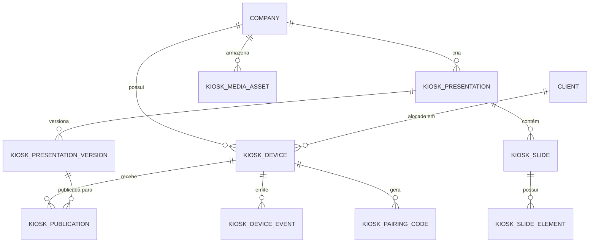

# Gestão de Totens — Descoberta do Repositório e Plano de Integração (Fase F0)

> Documento oficial de descoberta técnica (Skill 00 — `repository-discovery`) elaborado antes da implementação do módulo de **Gestão de Totens (Digital Signage / Interactive Kiosk CMS)** no FluxBus.
> Alinhado integralmente com o PRD, SDD, Especificações Funcionais, Plano de Testes e Decisões de Arquitetura validadas.

---

## 1. Decisões Estratégicas Confirmadas

1. **Armazenamento de Mídia:** MinIO habilitado como Object Storage oficial nos ambientes de CI/DEV/PROD com bucket `kiosk-media`, mantendo fallback em disco local apenas no perfil `local`.
2. **Escopo Completo Incorporado:**
   - Formulários interativos (`FORM`) com respeito às diretrizes de privacidade/LGPD e expiração de dados locais.
   - Conteúdo Web Externo (`WEB_CONTENT`) restrito a domínios permitidos (whitelist declarativa com sandbox de segurança).
   - Agendamento de publicações (`RF-018`) com fuso horário e política de fallback.
3. **Player Dedicado:** Criado no monorepo no diretório `player/`, compartilhando a biblioteca e o motor central `kiosk-engine` com o Preview do painel web.
4. **Abrangência de Acesso & Perfis:**
   - Permissões: `KIOSK_READ` (Visualizador), `KIOSK_EDIT` (Editor), `KIOSK_PUBLISH` (Publicador) e `KIOSK_ADMIN` (Administrador de Dispositivos/Configurações).
   - Perfis com acesso concedido por padrão: `SUPER_ADMIN`, `ADMIN`, `COMPANY_ADMIN`, bem como todos os usuários do Comercial (`COMERCIAL`, `GESTOR_COMERCIAL`, `VENDAS`) e Gestão de Clientes (`CLIENT_MANAGER`, `CLIENT_USER`).
5. **Hierarquia e Token de Totens (Multi-empresa & Multi-cliente):**
   - Cada Totem pertence obrigatoriamente a uma **Empresa (Tenant)** e, opcionalmente, a um **Cliente** contratante daquela empresa (ex: Totem instalado na recepção ou fábrica de um cliente).
   - O pareamento gera um Token de Dispositivo exclusivo (`KioskDeviceCredential`) que identifica a Empresa e o Cliente vinculado, assegurando que o totem receba e execute somente as apresentações autorizadas para o seu escopo.
6. **Entrega Documental:** Este documento formaliza o encerramento da Fase F0.

---

## 2. Diagnóstico da Arquitetura Atual

| Componente | Stack Atual | Integração do Módulo de Totens |
|---|---|---|
| **Backend** | Java 17 + Spring Boot 3.2.2 (Gradle) | Subpacotes coesos `com.z7design.fleet_manager.*.kiosk` nas camadas `model`, `repository`, `service`, `controller`. |
| **Frontend** | React 18 + Vite 7 + TypeScript + Tailwind 3 + shadcn | Rotas `/totens/*` integradas ao `App.tsx` e `CollapsibleSidebar.tsx`, com engine visual compartilhado em `kiosk-engine`. |
| **Segurança** | JWT Stateless + Spring Security | Filtro `DeviceAuthenticationFilter` dedicado para chamadas de totem `/api/player/**`, sem poluir o contexto de usuários humanos. |
| **Multi-Tenancy** | `TenantAware` + Hibernate `@Filter("tenantFilter")` | Aplicado a todas as entidades do módulo (`company_id` obrigatório + `client_id` relacional). |
| **Banco de Dados** | PostgreSQL 15 + Flyway Migrations | Migrations sequenciais `V4688+` gerando o schema relacional e inserindo permissões/roles. |
| **Tempo Real** | STOMP sobre WebSocket (`/ws` nativo e `/ws-sockjs`) | Destino `/topic/kiosk/{deviceId}` para notificação em tempo real de novas versões publicadas. |
| **Armazenamento** | MinIO SDK 8.5 integrado ao Spring | Bucket `kiosk-media` para vídeos MP4/WebM e imagens com geração de hash SHA-256 e URLs pré-assinadas para downloads resilientes. |

---

## 3. Modelo de Entidades e Relacionamentos

---

## 4. Cronograma de Execução

- **Fase F0 (Concluída):** Leitura de documentação, inspeção de repositório, validação socrática de premissas e geração do documento de descoberta.
- **Fase F1 (Fundação):** Schema Flyway, Entidades JPA, Repositórios, Permissões/Roles no banco e na UI, e estrutura base de rotas.
- **Fase F2 (Dispositivos & Pareamento):** CRUD de Totens, geração de código de pareamento com TTL, autenticação de dispositivo e heartbeat.
- **Fase F3 (Biblioteca de Mídias):** Upload no MinIO, metadados, validação MIME, checksum SHA-256 e geração de thumbnails.
- **Fase F4 (Apresentações & Engine):** Motor de interpretação do manifesto declarativo (`kiosk-engine`), slides, transições, botões, vídeos, QR Codes e formulários.
- **Fase F5 (Editor Visual & Preview):** Interface WYSIWYG no painel administrativo, manipulação de camadas, drag-and-drop e simulação de resoluções/orientações.
- **Fase F6 (Publicação, WebSocket & Sync):** Criação de versão imutável, notificação STOMP, sincronização incremental e rollback.
- **Fase F7 (Player PoC & Execução Offline):** Runtime web com IndexedDB/CacheStorage para execução sem internet.
- **Fase F8 (Monitoramento, Eventos & Logs):** Dashboard operacional de totens, status online/offline, métricas e alertas.
- **Fase F9 (Homologação & Empacotamento):** Verificações de segurança, testes E2E e validação multiplataforma.

